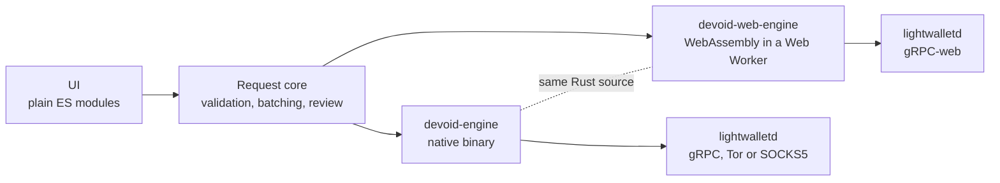

<p align="center"></p>

<h1 align="center">Devoid at the Zecathon</h1>

<p align="center"><b>One transaction. Multiple payments.</b><br>
A non-custodial Zcash wallet that pays a whole list of people in one shielded transaction.</p>

<p align="center">
  <a href="https://devoid-wallet.site/app/"><b>Try it</b></a> ·
  <a href="https://devoid-wallet.site/">Website</a> ·
  <a href="https://devoid-wallet.site/docs.html">Docs</a> ·
  <a href="docs/STATUS.md">Verification log</a> ·
  <a href="README.md">README</a>
</p>

| | |
|---|---|
| **Event** | Zecathon, hosted by [@zksnarks_](https://x.com/zksnarks_) |
| **Track** | Shielded Payments |
| **Team** | [@otxdave_](https://x.com/otxdave_) · [@0x_TIMii](https://x.com/0x_TIMii) |
| **Project** | [@devoidwallet](https://x.com/devoidwallet) |
| **Status** | Live on mainnet, from the desktop and from the browser |

<picture>
  <source media="(prefers-color-scheme: dark)" srcset="site/img/overview-dark.jpg">
  
</picture>

---

## Judges: five minutes

1. **Try it without funds.** Open [devoid-wallet.site/app](https://devoid-wallet.site/app/) and
   choose **Demo**: a simulated chain with play money, labelled on every screen. Create a wallet,
   open **Send → Paste a list**, add a few lines of `address,amount,memo`, then **Check recipients**,
   **Review payment**, and confirm.
2. **Check that it's real.** Open the transactions below in any Zcash explorer. Each fee is the
   one the review screen quoted before signing.
3. **Read the code that did it.** The signing path is in
   [`engine/src/spend.rs`](engine/src/spend.rs): parse the batch, propose, analyse what the chain
   will see, fingerprint it, and refuse to sign anything that differs from what was reviewed.

| What | Network | Transaction | Block | Fee |
|---|---|---|---|---|
| Shielded batch to 2 recipients with memos, native engine | Mainnet | [`82731e0e…`](https://blockchair.com/zcash/transaction/82731e0e0e7d007c1ebdd9d0eef4ea2566e1fce2053f32216169340462c88339) | 3,522,904 | 0.00015 ZEC |
| Payment built and proved in the browser (WebAssembly) | Mainnet | [`f95a7846…`](https://blockchair.com/zcash/transaction/f95a784645e6258406d01c218ab28720f3b7583c8e9232d8aae776f70e81044d) | 3,522,951 | 0.0001 ZEC |
| Shielded batch under NU7, native engine | Testnet | `ba406e5bf48a377b41a3897e0bc14571967d13ce5aeb283e8cde47eecf16ad50` | 4,534,144 | 0.00015 TAZ |
| Shielded batch under NU7, in the browser | Testnet | `e454e9c19eda5bde4a95a2aacdcd2f427205b6a74ab7cba0c99a92fe878a55cc` | 4,534,177 | 0.0001 TAZ |
| Three recipients, padded to five payment slots | Testnet | `4fbde3662e5c7b179eae8bd8e09a34da10510f412a4f80e0c2767ff4273ea129` | 4,536,660 | 0.0003 TAZ |

---

## The problem

Payroll, grants and DAO payouts all mean paying many people at once. On a transparent chain that
publishes every recipient and every amount. On Zcash the privacy is there, but the tools are built
for one payment at a time: forty contributors means forty transactions, forty fees and forty
signatures, and every payment links back to the same sender.

Teams that want to pay privately end up choosing between a spreadsheet of manual sends and a
custodial service that sees everything. We wanted the third option: paste the list, see exactly
what the chain will see, sign once.

## What Devoid does

- **One transaction for up to 25 people**, and a list of up to 2,000 sent as a few transactions,
  in order, with a receipt listing every transaction ID.
- **Every row checked as you type**: wrong network, duplicates, missing amounts, addresses it
  cannot read. Paste a list, import a CSV, or pick from contacts and saved lists.
- **One review before signing**: the total, the exact ZIP 317 fee, what you will have left, and a
  privacy report on what the chain will see. Paying a transparent address, or moving money between
  pools, needs an explicit acknowledgement.
- **What you review is what you sign.** A fingerprint binds the reviewed proposal to the signed
  one; if anything changes in between, the send is refused.
- **Your keys stay on your device.** The web wallet runs entirely in the browser with no Devoid
  server, keys encrypted with your passphrase. It never asks for a recovery phrase.
- **Easy to come back to.** Install it to a home screen, unlock with a passkey, or carry the wallet
  to another browser with an encrypted wallet file.
- **Optional padding** rounds a transaction up to 5, 10 or 25 payment slots, so the output count
  does not give away how many people were paid.

## How we built it



- **One Rust engine, two targets.** The wallet logic is written once on librustzcash
  (`zcash_client_backend`, `zcash_client_sqlite`, `orchard`, `sapling-crypto`) and compiled both to
  a native binary for the desktop app and to WebAssembly for the browser. Only a small platform
  layer differs.
- **A real wallet in the browser.** The WebAssembly engine proves Sapling and Orchard on a single
  thread, keeps its SQLite database in IndexedDB from a Web Worker, and reaches lightwalletd over
  gRPC-web, under a strict content security policy that allows no third-party code.
- **One request core** shared by the desktop server and the web build, so validation, batching and
  the review behave identically everywhere.
- **No runtime dependencies in the UI**, no build step, no analytics, no accounts.
- **Tests that drive the real thing:** 252 unit and API tests, browser tests that walk every screen
  from 320 to 1440 px in light and dark under the production headers, a layout checker that fails
  on any overlap, and live runs against testnet and mainnet.

## Challenges we ran into

- **A browser has no system clock for Rust.** Our first mainnet send from the browser built and
  proved the transaction, then panicked: the wallet library stamps each transaction with
  `OffsetDateTime::now_utc()`, which aborts in WebAssembly. Nothing had been broadcast. The fix was
  one feature flag, and the in-browser self-test now checks the clock so it cannot come back.
- **SQLite in a browser.** `rusqlite` cannot build SQLite for `wasm32-unknown-unknown`, so we wrote
  a small shim crate that routes it to a WebAssembly SQLite with an in-memory file system, saved to
  IndexedDB.
- **Proving parameters bigger than the host allows.** The Sapling spend parameters are 48 MB; the
  host serves 25 MiB per file. They ship in two parts, are joined in the worker, and are checked
  against their published hash before use.
- **NU7 is coming.** Testnet already runs Zcash's next network upgrade, and every wallet on the old
  libraries has its sends rejected there. Moving to the NU7 release meant a new `rand` major version and 25 compile errors
  across both engines. Both now send on the NU7 testnet, ahead of the mainnet activation at block
  3,543,405.
- **Our own fee estimate was wrong.** The live mainnet run quoted 0.00015 ZEC for a batch our UI
  had estimated at 0.0001: the estimate forgot that change is an output too. The engine's quote was
  always exact; the UI estimate now matches it.

## Accomplishments we're proud of

- Real shielded payments **mined on Zcash mainnet from both engines**, including one built and
  proved entirely inside a browser tab.
- **On NU7 before mainnet is**, with confirmed testnet batches from both engines.
- A web wallet that **never takes a recovery phrase**, so no one is ever trained to type one into a
  website, yet still lets you carry the wallet anywhere with an encrypted file.
- Passkey unlock done the honest way: the WebAuthn PRF secret actually decrypts the passphrase,
  and a device without PRF is declined rather than given a weaker imitation.
- **No fake confirmations anywhere.** The demo engine is labelled on every screen, and the
  verification log records each run, including the failures.

## What we learned

- Shielding hides who and how much, but a batch has properties of its own: the output count and
  the fee are public, and with many recipients they say something. That is what led to padding.
- Privacy UX is mostly about the moment before signing. People trust a payment when they can see
  what will be public, in plain language, before they commit.
- Compiling the same Rust to native and to WebAssembly is very achievable with librustzcash, but
  every assumption about threads, clocks, files and randomness has to be found and replaced.

## What's next

- **Air-gapped signing with PCZT**, so the spending key never sits on a networked machine, then
  **FROST threshold approval**: two of three signatures before a payroll batch goes out.
- **Funding payroll from stablecoins** through cross-chain intents, so one public deposit replaces
  forty public payments.
- **A Chrome extension and mobile apps** on the same in-browser engine.
- **Faster proving on the web** with WebAssembly threads.

## Run it yourself

```bash
git clone https://github.com/davebrian259-tech/Devoid.git && cd Devoid
node server/index.mjs --demo        # the whole app on a simulated chain, no Rust needed
npm run engine:build                # real Zcash: build the engine (Rust 1.88+)
node server/index.mjs
npm test                            # 252 unit and API tests
```

More in the [docs](https://devoid-wallet.site/docs.html), the [engine protocol](docs/ENGINE_PROTOCOL.md)
and the [deploy guide](docs/DEPLOY.md).

## Built with

Rust · librustzcash (`zcash_client_backend`, `zcash_client_sqlite`, `orchard`, `sapling-crypto`) ·
WebAssembly · lightwalletd and gRPC-web · SQLite · JavaScript (no framework) · WebAuthn ·
Cloudflare · Playwright

---

<p align="center">Open source under MIT (the engine under MIT or Apache-2.0). Built on librustzcash from the Electric Coin Company and the Zcash Foundation.</p>
