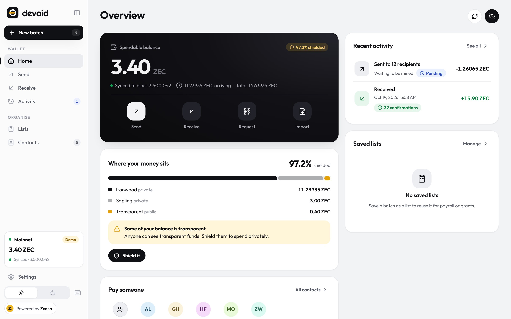
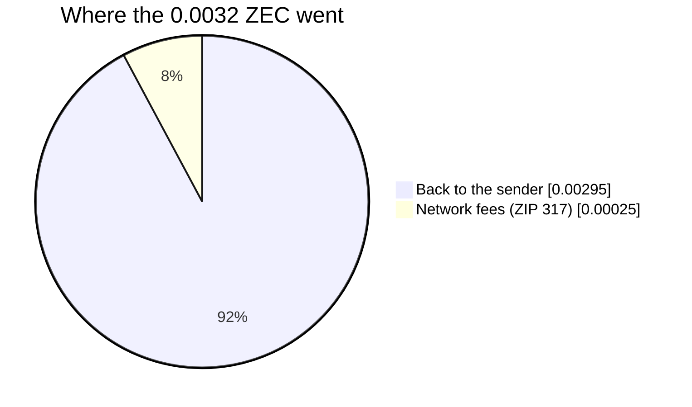
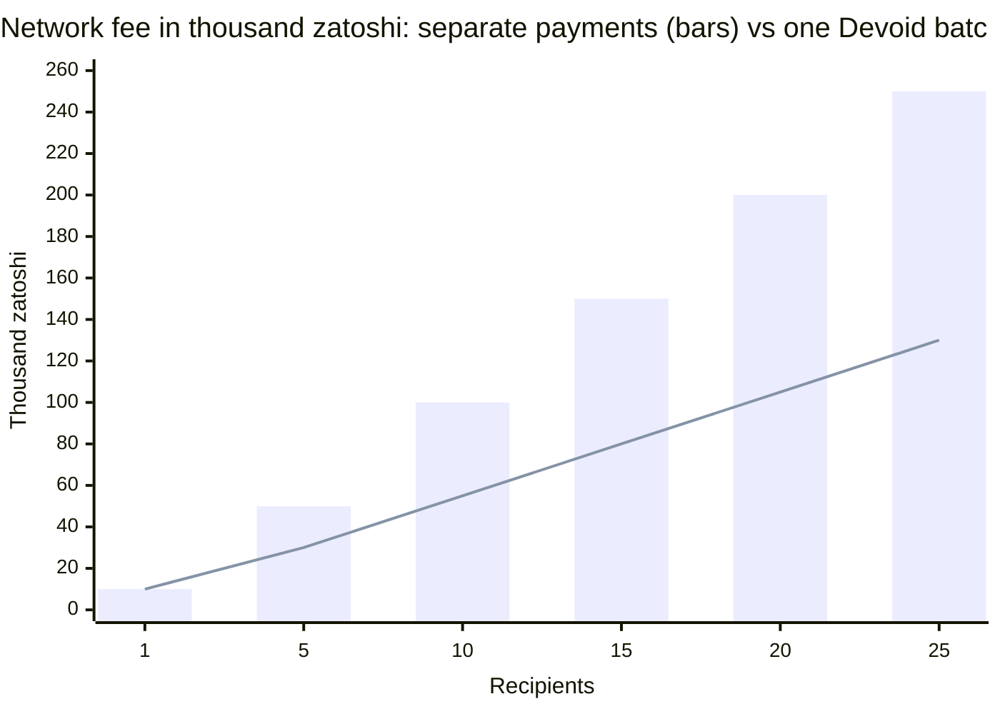
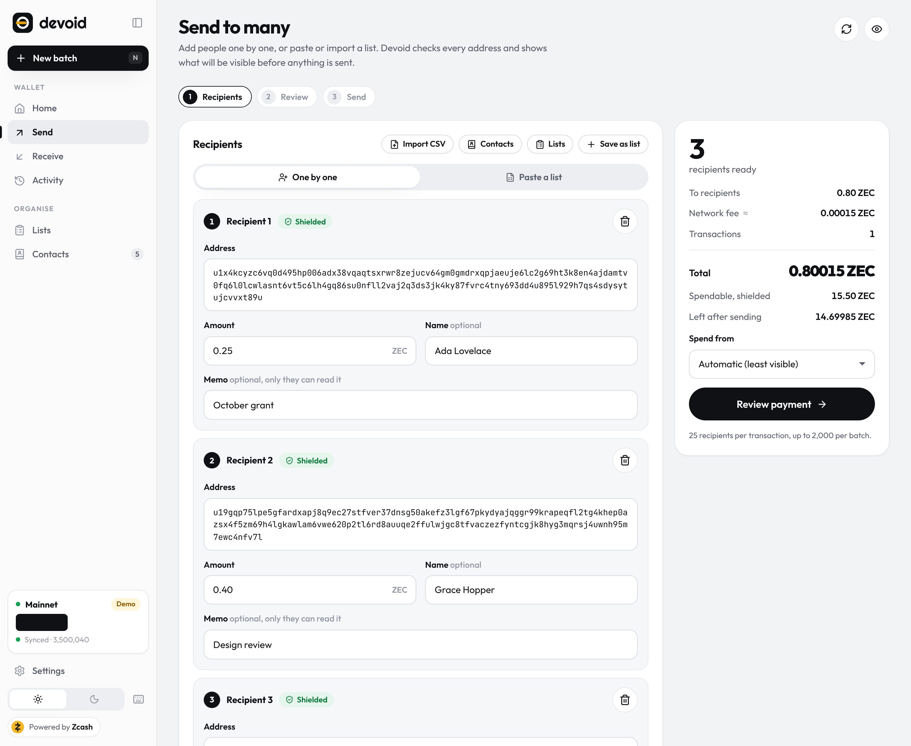
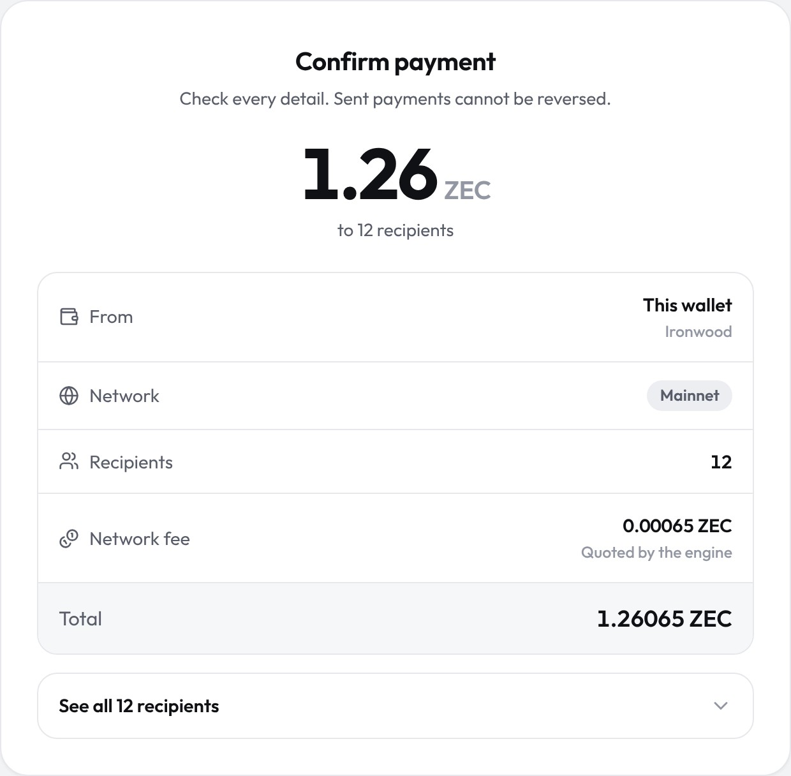
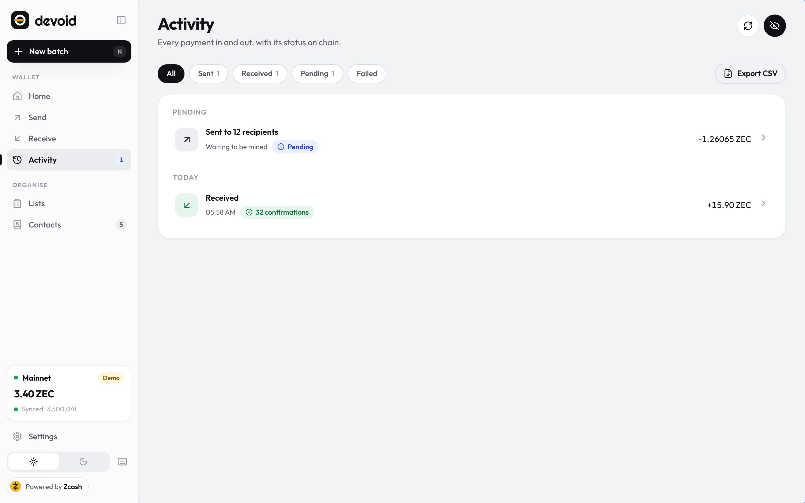
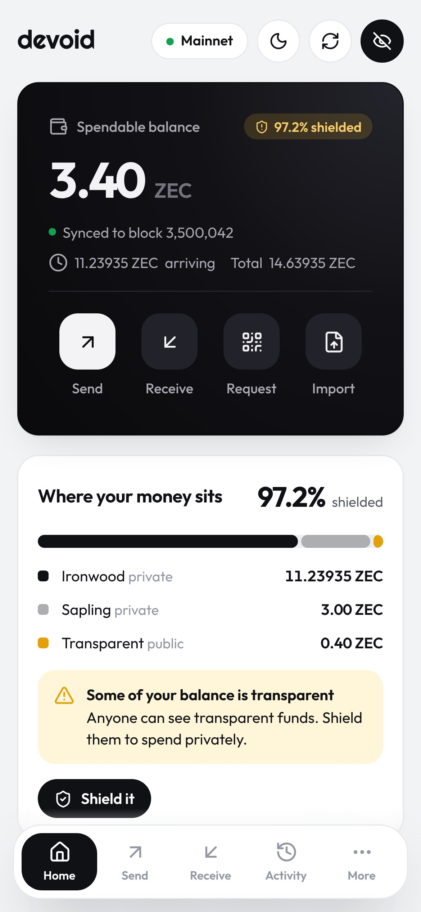
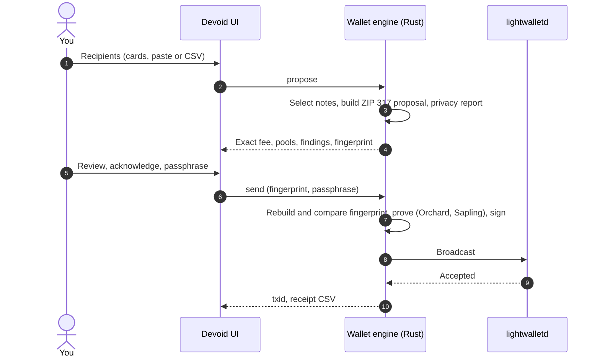
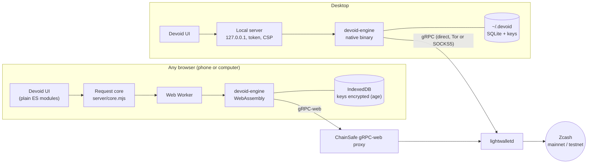

<p align="center"></p>

<h1 align="center">Devoid</h1>

<p align="center"><b>Pay everyone at once. Privately.</b><br>
A non-custodial Zcash wallet that pays a whole list of people in one shielded transaction,
without revealing how many were paid.</p>

<p align="center">
  
  
  
  
  
  
</p>

<p align="center">
  <a href="https://devoid-wallet.site/app/"><b>Open the web wallet</b></a> ·
  <a href="https://devoid-wallet.site/">Product page</a> ·
  <a href="docs/STATUS.md">What is verified</a> ·
  <a href="docs/ENGINE_PROTOCOL.md">Engine protocol</a>
</p>

<picture>
  <source media="(prefers-color-scheme: dark)" srcset="site/img/overview-dark.jpg">
  
</picture>

Payroll, grants and DAO payouts mean paying many people at once. On a transparent chain that
publishes who was paid and how much. One transaction per person costs more and links every
payment to the same sender. Devoid builds **one shielded Zcash transaction for up to 25
recipients**: the chain sees that a transaction happened and its size, never who got what. A
list of up to 2,000 people goes out as a few transactions, in order.

### What the chain reveals

A shielded transaction conceals payment amounts and recipient details. It does not conceal how
many. Output counts are public, and a ZIP 317 fee is 5,000 zatoshis per logical action, so the fee
itself offers a clue about the size of a batch: a payroll of 40 looks nothing like one of 3. Every
shielded wallet works this way, and it starts to matter once you pay people in batches.

Devoid can pad a transaction to 5, 10 or 25 payment slots by adding shielded outputs that carry no
value and go to your own wallet. On chain they are indistinguishable from the payments beside them,
so a smaller batch resembles a larger one: one recipient looks like five, six looks like ten. Each
padding output adds one logical action to the fee — 0.0001 ZEC to pad three recipients up to five,
quoted before you sign — and a batch that already fills the slot costs nothing extra. Padding
protects one transaction rather than a payment history: a batch over 25 recipients is sent as
several transactions, and that still indicates its rough size, which the privacy report says.

Verified on testnet: [`4fbde366…`](https://testnet.zcashexplorer.app/transactions/4fbde3662e5c7b179eae8bd8e09a34da10510f412a4f80e0c2767ff4273ea129)
pays three recipients in block 4,536,660 and produces six outputs — five payments and the change —
the count a five-recipient batch would produce.

## Proven on mainnet

On 2026-10-19 a fresh wallet received 0.0032 ZEC. It then paid out through **both** of
Devoid's engines, and every step was mined:

| Step | Engine | What happened | Fee (quoted before signing) | Transaction | Block |
|---|---|---|---|---|---|
| 1 | — | 0.0032 ZEC received | — | [`2f6c81a1…`](https://blockchair.com/zcash/transaction/2f6c81a11077472d5d91b386dfcc25ad0c3a9355ac0314c8728fdabad1287835) | 3,522,773 |
| 2 | Native (Rust) | A shielded batch to 2 recipients with memos | 0.00015 ZEC, exact | [`82731e0e…`](https://blockchair.com/zcash/transaction/82731e0e0e7d007c1ebdd9d0eef4ea2566e1fce2053f32216169340462c88339) | 3,522,904 |
| 3 | Web (WebAssembly, in the browser) | The rest sent back, proved in the page in 60 s | 0.0001 ZEC, exact | [`f95a7846…`](https://blockchair.com/zcash/transaction/f95a784645e6258406d01c218ab28720f3b7583c8e9232d8aae776f70e81044d) | 3,522,951 |



**And on testnet, under NU7.** Zcash activates its next network upgrade, NU7, on mainnet at block
3,543,405 (expected 2026-11-05); testnet has run it since block 4,465,026. Devoid is already on the
NU7 libraries, and on 2026-10-24 both engines sent shielded batches that the NU7 testnet accepted
and mined: `ba406e5b…` in block 4,534,144 (native) and `e454e9c1…` in block 4,534,177 (in the
browser). A wallet still on the older libraries will have every mainnet send rejected from block
3,543,405 on.

The full log, including a bug this run caught before it reached anyone, is in
[`docs/STATUS.md`](docs/STATUS.md).

## Why one transaction

Zcash fees follow ZIP 317: 5,000 zatoshi per logical action, with a minimum of two. A batch pays
for each recipient plus one change output. Separate payments pay the two-action minimum every time,
and each one is a fresh link back to the payer.



| Recipients | One transaction each | One Devoid batch | Saved |
|---:|---:|---:|---:|
| 5 | 0.0005 ZEC | 0.0003 ZEC | 40% |
| 10 | 0.001 ZEC | 0.00055 ZEC | 45% |
| 25 | 0.0025 ZEC | 0.0013 ZEC | 48% |

The quote shown before signing is the engine's own, built from the real notes the wallet would
spend, and it is the fee the transaction pays.

## The workflow

<table>
  <tr>
    <td width="58%"></td>
    <td></td>
  </tr>
  <tr>
    <td><b>1. Add recipients</b> one card at a time, or paste or import a CSV of up to 2,000.
    Every address is checked as you type and shows the pool it will be paid into.</td>
    <td><b>2. Review</b> the exact fee and what the chain will reveal. Anything public, like a
    transparent recipient, needs an explicit acknowledgement.</td>
  </tr>
  <tr>
    <td></td>
    <td></td>
  </tr>
  <tr>
    <td><b>3. Send and track.</b> One passphrase, one signature. A fingerprint ties what you reviewed
    to what is signed. Activity follows each payment from pending to confirmed.</td>
    <td><b>Anywhere.</b> The same app on a phone, with nothing to install: the wallet runs
    in the browser.</td>
  </tr>
</table>



## How it works

The wallet engine is one Rust codebase built on **librustzcash** (`zcash_client_backend`,
`zcash_client_sqlite`, Orchard, Sapling). It compiles to a native binary for the desktop and
to **WebAssembly** for the browser. A per-platform module swaps in storage, network, clock and
prover. Both builds speak the same JSON protocol to the same UI and request core.



The hard parts of the browser build:

- **librustzcash in a browser tab, single-threaded.** Multicore proving in halo2 and bellman is
  switched off, and rayon jobs are run on the calling thread so scanning never deadlocks.
- **SQLite in memory, saved to IndexedDB.** A small shim replaces `libsqlite3-sys` with
  `sqlite-wasm-rs`. After every command that changes the wallet, the files are saved.
- **Every clock goes through JavaScript.** `SystemTime` panics in WebAssembly; the wallet
  database, sync deadlines and transaction timestamps read `Date.now()` instead. The mainnet run
  found the last one.
- **Sapling parameters on demand.** The 48 MB spend parameters download only when a payment
  spends Sapling notes. They are served in two parts and checked against the published BLAKE2b
  hashes.
- **A strict CSP.** The page may only talk to its own origin and the gRPC-web servers
  (`script-src 'self' 'wasm-unsafe-eval'`). There is no Devoid server, and the web version never
  asks for a recovery phrase.

## What stays private

| | The chain | The lightwalletd server | Only you |
|---|:-:|:-:|:-:|
| That a transaction happened, its size and fee | ✓ | ✓ | ✓ |
| Recipients, amounts, memos (shielded) | — | — | ✓ |
| Your IP address | — | ✓ (desktop: hide it with Tor) | ✓ |
| Keys and recovery phrase | — | — | ✓, encrypted with your passphrase |
| Transparent recipients or pool crossings | ✓ | ✓ | flagged before you sign |

## Try it

**In a browser, nothing to install.** [Open the web wallet](https://devoid-wallet.site/app/)
on a phone or computer and choose:
- a **real wallet** on mainnet (it asks you to confirm that it holds real ZEC) or testnet;
- a **demo** with play money on a simulated chain.

**On your computer, simulated chain** (Node 20+, no dependencies):
```
npm run demo        # node server/index.mjs --demo, then open the link it prints
```

**On your computer, for real** (Rust 1.88+):
```
npm run engine:build      # engine/target/release/devoid-engine
npm run engine:selftest   # 10 offline checks, including the Sapling proving parameters
npm start                 # uses the real engine, data in ~/.devoid
```
If your network inspects TLS with its own certificate authority, set `DEVOID_CA_FILE` to a PEM
bundle; those certificates are added to the built-in roots, never replacing them. On Windows, use
WSL: [`docs/WSL.md`](docs/WSL.md).

**Build and deploy the site.** Run `npm run build` to write `dist/`. Run `npm run build:engine`
to rebuild the WebAssembly engine (needs Rust and wasm-bindgen). Cloudflare settings are in
[`docs/DEPLOY.md`](docs/DEPLOY.md).

## Features

- **Batch send**: one card per recipient, paste a list, import CSV, or pick contacts and saved
  lists. Tools: one amount for everyone, split a total to the zatoshi, remove bad rows. Up to 25
  recipients per transaction and 2,000 per batch.
- **Review**: total, source pools, network, exact fee and a privacy report. Public disclosures
  need explicit acknowledgement. A receipt CSV marks who was paid, even if a multi-transaction
  batch stops halfway.
- **Padding**: round a transaction up to 5, 10 or 25 payment slots, so the output count reveals
  less about how many people were paid. Optional, with the added fee quoted before you sign.
- **Receive**: unified, Sapling and transparent addresses with QR codes, fresh addresses, and
  ZIP 321 payment requests.
- **Activity**: pending, confirmed and expired, grouped by day, with per-output detail and CSV
  export.
- **Contacts and lists** for payroll, grants and DAO payouts.
- **Setup and settings**: create (or restore, on the desktop), a backup check, passphrase change,
  phrase reveal, shielding of transparent funds, and Tor or SOCKS5 on the desktop.
- **Staying signed in**: after you sign once, the wallet stays unlocked in that tab for 15 minutes
  (the passphrase in memory only, never stored; Lock any time). On the web, a **wallet file**
  (encrypted with your passphrase) opens the same wallet in any browser or on any device, with no
  recovery phrase typed into a website, and the browser is asked to keep the wallet's storage. The
  desktop app keeps its access key across restarts, so `http://127.0.0.1:8787` opens straight
  back into the wallet.
- **Light and dark**, a phone layout, keyboard shortcuts, and the network marked on every screen.
- **Installs to a home screen**, opens in its own window and works offline: the service worker
  keeps one whole version of the app at a time, so its files never come from two different builds.
- **Unlock with a passkey** rather than a typed passphrase. Not a login: there is no account and no
  server. The authenticator derives a secret of its own (the WebAuthn PRF extension); that key
  encrypts the passphrase into this browser, and your face, fingerprint or PIN decrypts it again.
  A device without PRF is turned down rather than quietly given something weaker, and the
  passphrase always works.

## Verification

| Check | How |
|---|---|
| 245 unit and API tests: Zcash address test vectors, amounts, CSV, SHA-256 (FIPS), fees, ZIP 321, server auth, web backend rules, wallet file encryption | `npm test` |
| Every screen and feature in a browser, failing on any console error or leaked `null` | `npm run test:ui` |
| The passkey wrap: what the device's secret protects, and what it refuses | `npm test` (`test/passkey.test.mjs`) |
| Padding: the bucket rule, the fee it adds, and a padded batch through the request core | `npm test` |
| The built site under its real CSP, desktop and phone, 320–1440 px, light and dark. Fails on any overlap, CSP violation or unexpected request. Includes the WebAssembly engine's self-test and a transaction proved in the browser | `npm run test:web` |
| The landing pages at seven widths from 320 to 1440 px, light and dark: no overlap, no clipped box, no sideways scroll, no broken image | `npm run test:site` |
| Installed and offline: the manifest, the service worker's cache, and the app opening with the network off. A passkey enrolled and used to unlock, against a virtual authenticator | `npm run test:web` |
| A live wallet through the UI on testnet and mainnet: create, sync to the tip, exact fee quote, persistence | `npm run test:live` |
| Engine: 11 Rust tests and a 10-check self-test | `cargo test`, `npm run engine:selftest` |
| Real payments on mainnet, from both engines | [`docs/STATUS.md`](docs/STATUS.md) |
| Real payments on testnet under NU7, from both engines | [`docs/STATUS.md`](docs/STATUS.md) |

A mainnet send under NU7 rules waits on the activation itself, at block 3,543,405 (expected
2026-11-05); both engines have already sent batches confirmed on the NU7 testnet.

## Project layout

```
engine/        Rust wallet engine (librustzcash), native binary, JSON protocol over stdin/stdout
web-engine/    the same engine built for WebAssembly: platform layer, gRPC-web, SQLite shim
ui/            the app: plain ES modules, no build step; ui/local/ is the in-browser backend,
               ui/engine/ the compiled engine and its worker
server/        local server for the desktop app, request core shared with the web, batch parsing
mock-engine/   simulated engine for the demo
site/          product page and privacy policy
scripts/       site build, engine build, browser tests, screenshots
test/          unit and API tests
docs/          protocol, status, deployment, Windows
```

## Roadmap

- **Air-gapped signing** with PCZT, so the spending key never sits on a networked machine, and
  then **FROST threshold approval**: two of three signatures before a payroll batch goes out.
- **Faster proving on the web** with WebAssembly threads, which need cross-origin isolation.
- **A Chrome extension**, then iOS and Android, all on the same in-browser engine.
- **ZIP 318 migration and TEX addresses.**

## Design and licences

Type: Righteous, Outfit and JetBrains Mono (SIL OFL), vendored in `ui/fonts`. Icons: Lucide (ISC).
The app is MIT. The engine is MIT or Apache-2.0 and builds on librustzcash from the Electric
Coin Company and the Zcash Foundation. Screens in this README show demo data from the simulated
engine; the mainnet transactions above are real.
